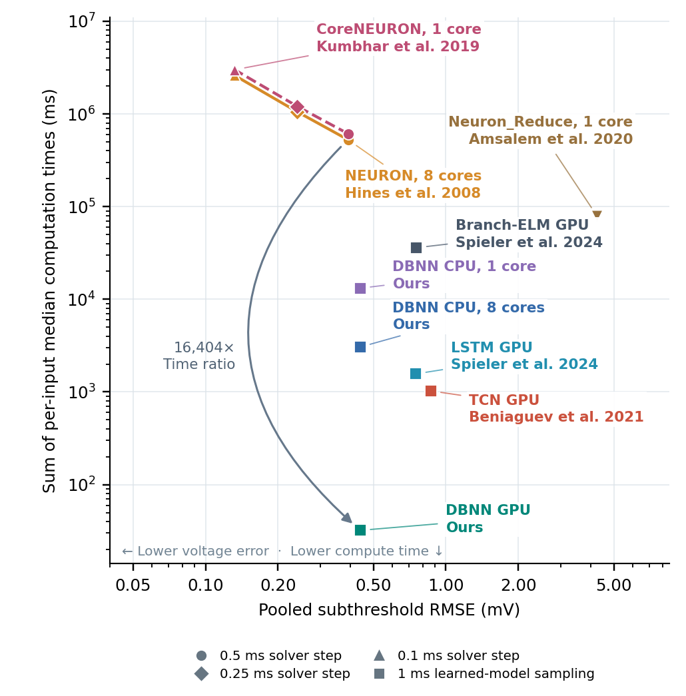

# DBNN: fast bilinear surrogates for single-neuron simulation

Code, locked models, input rasters, reference trajectories, predictions, and
numerical records supporting the study prepared for *Journal of Scientific Computing*.
DBNN uses sitewise temporal filters, a bilinear voltage readout, and a causal
threshold/reset stage. The same primary fitted model runs on CPU and GPU.

Authors: Chongming Liu, Jingyang Ma, Yeqiang Liao, Songting Li, and Douglas Zhou.
Chongming Liu and Jingyang Ma contributed equally.
Corresponding authors: Songting Li (`songting@sjtu.edu.cn`) and Douglas Zhou
(`zdz@sjtu.edu.cn`).

## Current release: 18 October 2026

The primary model, reset parameters, inputs, and trained weights are unchanged.
This release synchronizes the repository with the final recorded comparison:

| Primary evaluation | Frozen value |
|---|---:|
| Input trajectories | 379 |
| Total simulated time | 2,497 s |
| Common NEURON reference step | 0.0125 ms |
| Reference spikes | 680 |
| DBNN pooled subthreshold RMSE | 0.440363586 mV |
| DBNN event F1, one-to-one within ±5 ms | 0.535269710 |
| Corrected Branch-ELM training updates | 350,000 |
| Cell/synapse conditions fitted separately | 12 |
| Fixed cross-cell test inputs | 182 per condition; 2,184 total |

The canonical aggregate is `paper/evidence/main379_results.json`.
The primary checkpoint remains SHA-256
`737efcff1e6686bfb153fca8590a8b28a605fbdb08f9a68ff44e68af8867686d`.
The corrected Branch-ELM checkpoint is
`96c192fcbba97b51d2085d0bd527ad826a5a414ae5b855a937e2a60d34583452`.
TCN uses whole-trajectory inference with unchanged weights and thresholds;
LSTM keeps its recorded overlapping-window evaluation. The shared training
split is 117 fitting and 32 validation trajectories. No test-driven checkpoint,
threshold, input, seed, or model replacement is performed by this release.



The previous 13 October commit used a 0.1 ms reference and older baseline
implementations. It is retained in Git history; those old headline values
must not be mixed with this release. Historical paths and dated folder names
are provenance, not separate definitions of DBNN.

## Verify the recorded results without training or a GPU

```bash
git clone https://github.com/liuchongming1999/DBNN-JSC.git
cd DBNN-JSC
python -m venv .venv
source .venv/bin/activate
pip install numpy
python scripts/verify_release.py
```

This checks file hashes, training/test disjointness, the main checkpoint,
all 13 primary model/solver rows from raw voltage arrays and events,
the 350,000-update ELM budget, timing medians, and all 12 cross-cell models
on their complete fixed panels. Output goes to `build/release_verification.json`.
Use `--primary-only` for the mouse comparison alone. The verification does not
train, recalibrate, or modify the frozen study evidence.

## Inference, fitting, and figure regeneration

See [REPRODUCING.md](docs/REPRODUCING.md) for exact entry points, data mappings,
requirements, numerical tolerances, training settings, and timing boundaries.
For the recorded GPU environment:

```bash
pip install torch==2.8.0 --index-url https://download.pytorch.org/whl/cu128
pip install -r requirements.txt
python scripts/prepare_workspace.py
python scripts/build_native.py --workspace build/workspace --cutlass /path/to/cutlass-3.9.2
python scripts/predict.py --workspace build/workspace --backend gpu
python scripts/predict.py --workspace build/workspace --backend cpu --threads 8
python scripts/replay_crosscell.py --cell granule --profile ampa --case new_granule_0000 --device cpu
```

Optimized CPU inference uses Linux x86-64, AVX-512, and MKL-enabled PyTorch.
The recorded GPU is an RTX 5090 with CUDA 12.8. The cross-cell replay command
is a portable FFT/sequential-reset reference, not a replacement timing backend.

## Evaluation scope

Voltage RMSE pools the 1 ms observation samples outside ±10 ms of reference
spikes. Event scoring uses inclusive ±5 ms one-to-one matching, with a 1e-6 ms
floating-point boundary allowance. Primary model timing is prepared computation
for one complete trajectory; packing, transfers, compilation, and graph capture
are excluded. The four GPU surrogate timings use seven paired repetitions;
solver and CPU records use three. Practical invocation and one-time costs are
reported separately. Timings are measurements on shared hardware, not guarantees
for another machine.

The 379-input mouse cohort was historically qualified for sparse firing using
its original 0.1 ms reference; membership is unchanged after refining the
reference. Cross-cell results are independently fitted models, not transfer
of one mouse model. Their fixed panels were evaluated for earlier fitting
recipes and replayed after validation-only selection; they are not a second
newly unseen panel. All 182 inputs per condition are retained regardless of
spike count or burst behavior. See [RESULTS.md](docs/RESULTS.md).

The separate unfiltered-637 and pressure-120 studies are not part of this
manuscript release. Their independent author archives are unchanged.

## Sources and disclosures

Third-party models and software retain their original terms and authorship;
see [THIRD_PARTY.md](docs/THIRD_PARTY.md). ModelDB mechanisms and upstream
comparison repositories are retrieved separately using `scripts/fetch_external.py`.
The repository contains simulation outputs generated for the study, not new
human or animal experiments.

OpenAI Codex assisted with code development, numerical analysis, organization
and English drafting of the manuscript, LaTeX preparation, and plotting recorded
results. The authors reviewed and edited the resulting material, verified the
scientific content, and take responsibility for the manuscript. In the manuscript,
this disclosure is now in Methods Section 3.2.
